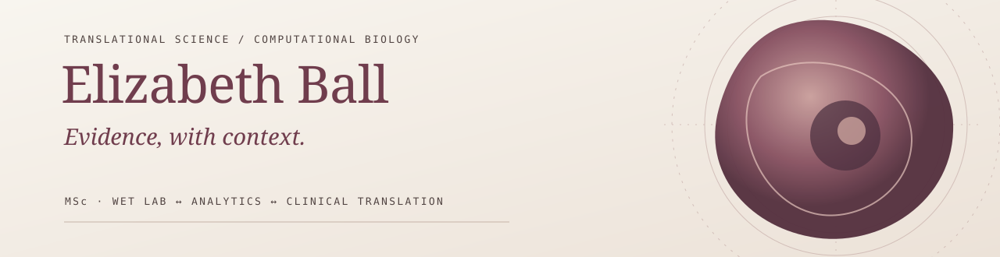

### Hi, I'm Elizabeth — a translational scientist working across molecular biology, clinical research and applied machine learning.

I connect **bench science, computational analysis and real-world interpretation** to ask better questions about human health. My practice spans wet-lab and patient-facing research through reproducible biomarker modelling, biostatistics and scientific communication.

I'm interested in **precision medicine, inflammation, women's health, rare disease, multi-omics and evidence that holds up beyond a single dataset**.

[**Research portfolio ↗**](https://lizzball.github.io/) &nbsp;·&nbsp; [**GitHub projects ↗**](https://github.com/lizzball?tab=repositories) &nbsp;·&nbsp; [**Veyra — science × story × place × practice ↗**](https://veyrainsights.com/)

---

### Selected work

| Project | Focus | What it demonstrates |
| :--- | :--- | :--- |
| [Endometriosis Biomarker Signal Lab](https://github.com/lizzball/endo-public-data) | Public serum miRNA · R | Assay provenance, leakage-aware nested validation, uncertainty and feature stability |
| [Thyroid Eye Disease Signal Lab](https://github.com/lizzball/biomarker-publicdataset-test) | GEO gene expression · R | Consistent tissue comparisons, repeated-sample handling and biological-subject-level validation |
| [Before Suzy Misses a Sale](https://github.com/lizzball/terminal-signal-lab) | Synthetic telemetry · ML | Risk modelling, longitudinal SQL features and operational threshold trade-offs |
| [Synthetic Diagnostic Laboratory](https://github.com/lizzball/builiding-SQL-course) | SQLite · synthetic data | Relational data modelling, joins and diagnostic-style threshold exploration |

These are **public-data research demonstrations and synthetic-data exercises**, not validated clinical tests or real-world commercial systems. Methodological assumptions and limitations are documented in each repository.

### Where I work

**Molecular and translational science**  
qPCR · miRNA · immunoassays · sequencing workflows · clinical research · assay development

**Data science and machine learning**  
R · Python · SQL · logistic regression · elastic net · random forests · XGBoost · biostatistics

**Rigorous evaluation**  
QC · nested cross-validation · ROC / precision–recall analysis · leakage prevention · confounding · uncertainty

### A note on how I think

> Good science isn't just finding a signal. It's knowing what that signal means — and where the evidence stops.

Beyond the code, I'm developing [**Veyra**](https://veyrainsights.com/): a complementary space for scientific strategy and visual storytelling, rooted in curiosity about the intersection of science, experience and place.

Elizabeth Ball, MSc · Translational Science · [Portfolio](https://lizzball.github.io/) · [Veyra](https://veyrainsights.com/)
